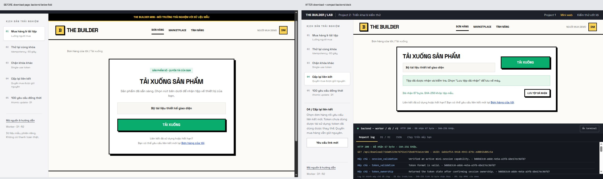

# Audit luồng mini web Project 2

Phạm vi: đơn mẫu → trang tải → đổi kịch bản → quan sát backend. Capture trực tiếp từ local trong lần audit này; không đánh giá toàn bộ marketplace. Người dùng chọn terminal mặc định mở gọn ở đáy. [Bằng chứng hình ảnh](evidence/mini-scroll-audit/images/) và [QA sau sửa](../design-qa.md).

## Các bước và phát hiện

1. **Bắt đầu phiên — ổn, cần giảm khoảng trống.** `01-start.png`: nhận diện The Builder và CTA rõ; header, khoảng đệm và footer chiếm chiều cao. Sau sửa giữ nhận diện, bỏ thông tin lặp và rút gọn bố cục.
2. **Chọn đơn — ổn sau sửa.** `02-orders.png`: đơn trả phí/miễn phí phân biệt được. `06-orders-fixed.png`: cả hai thẻ vừa vùng người mua trên desktop khi terminal mở.
3. **Tải tệp — trước sửa khó quan sát backend, đã sửa.** `03-download.png`: nút tải rõ nhưng terminal ngoài màn hình. Document download+terminal mở cao1362px ở viewport1280×720. `11-final-desktop.png`: document720px, CTA và phản hồi backend cùng hiện; đã nhận67byte và SHA-256 khớp.
4. **Đổi kịch bản — trước sửa thao tác cách xa menu, đã sửa.** `04-scenario.png`: menu bên trái nhưng hướng dẫn/nút chạy ở dưới website. Sau sửa đặt chúng cạnh menu; mobile dùng select có nhãn. Điều kiện chưa đạt được giải thích ngay tại nút. Đổi menu không tự chạy request, không làm mất đơn/token.
5. **Đọc backend — trước sửa phải rời nút tải, đã sửa.** `05-terminal.png`: tại scrollY642, CTA nằm phía trên màn hình. Terminal mới mở gọn, có tóm tắt HTTP và bốn mục; nội dung dài cuộn riêng. `08-race-fixed.png`:100 phản hồi thật cho1 thành công/99 từ chối; lưới và website cùng hiện. `09-mobile-fixed.png`: nút tải, xác nhận byte và terminal cùng hiện trên390×844.

## Mức ưu tiên và kết quả

- **P1:** không xem được thao tác và phản hồi cùng lúc → chia chiều cao vùng website/terminal, giảm khoảng trắng; desktop không cuộn document.
- **P2:** menu và nút chạy xa nhau → hướng dẫn/nút đặt cùng vùng điều khiển, có thông báo điều kiện.
- **P2:** điều khiển hẹp trên mobile → select có nhãn, nội dung xếp cột, không tràn ngang ở375/390px.
- **P2:** khó truy cập vùng log bằng bàn phím → vùng cuộn có tên và tabindex; Enter đóng/mở, End cuộn được JSON dài.

Điểm giữ lại: thương hiệu nhất quán, CTA tải rõ, trace thật từ handler, D1 trước/sau và checksum độc lập. Không sửa backend hoặc mở rộng chính sách tải trong lần này.

## Giới hạn và khả năng truy cập

Trên390×844 sau tải thành công, vùng website cao384px/nội dung434px: còn50px cuộn nội bộ để đọc hết phần trợ giúp; nút tải, kết quả và lưu tệp vẫn hiện. Terminal cuộn riêng để đọc log dài. Màn hình900×500 cho phép cuộn document để không cắt mất điều khiển. Đây là lựa chọn để giữ nút truy cập được, không cam kết không cuộn ở mọi kích thước.

Đã kiểm tra focus vùng cuộn, nhãn select, Enter và aria-expanded, thông báo trạng thái, không tràn ngang, console không có lỗi/cảnh báo ở lần quan sát cuối. Chưa kiểm tra screen reader, mọi trình duyệt hay toàn bộ tiêu chí WCAG. Capture không chứng minh hiệu năng hoặc hoàn tất lưu tệp ở hệ điều hành. Kết quả tự động và quan sát trình duyệt được công bố riêng, gắn đúng commit nguồn trong bundle.

